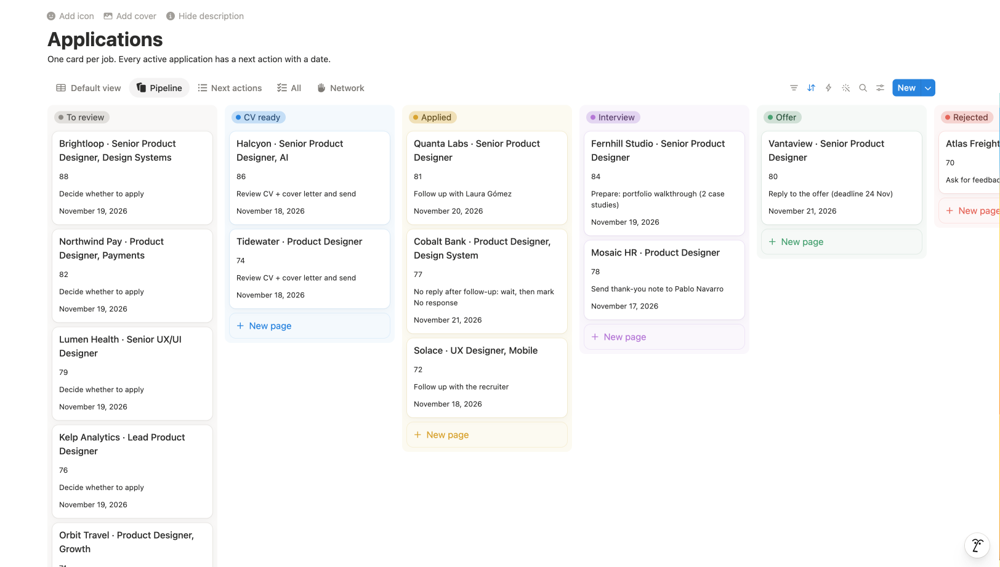
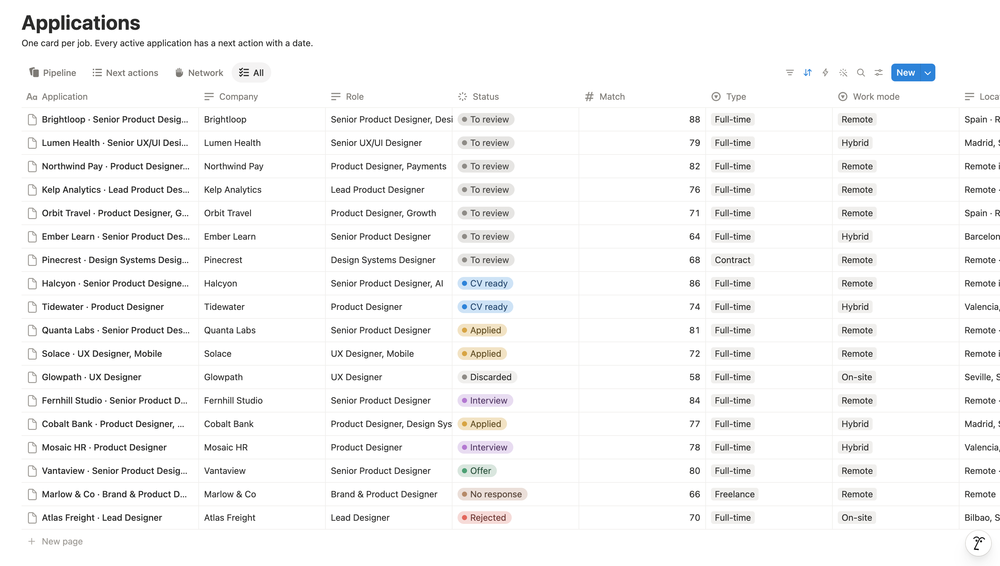

# Open Source Job Search Kit

An AI job-search copilot you run with your AI agent: Claude, Codex, Cursor or any agent that can read files and use MCP. It finds roles that fit you, tailors your CV and cover letter for each one (in Figma, or in Word, Pages or Google Docs), and keeps every application tracked in Notion. You review everything before it goes anywhere.

Built by a product designer for her own job search, then stripped of personal data and shared as a template.

**Tailored CV and cover letter in Figma**: your base files stay untouched, and each role gets its own dated section with both documents:


Close-up of one section:


**Every application tracked in Notion**, with a status, a colour-coded match score, a saved copy of the job posting and one next action with a date:






<sub>All names, companies and numbers in these images are fictional.</sub>

## Try it in 2 minutes (demo)

No Figma, Notion or keys needed. Clone the repo, open it with your agent (Claude Code, Codex, Cursor, or the Claude desktop app with the folder connected) and say **"Run the demo"**. It searches real job boards for a fictional designer (Alex Doe, `examples/demo/`), scores the roles in the chat and tailors a CV and cover letter as text in `_test-applications/` (git-ignored).

## Quick start

1. Put your current CV in `context/` (PDF, Word export, Markdown or text). **This is the most important step:** the setup reads it and only asks what it can't find, about 10 questions instead of 30.
2. Check the [checklist](#before-you-start-checklist). Notion connected is enough to start; Figma is optional (Word, Pages and Google Docs work too).
3. Open your agent (Claude Code, Codex, Cursor, the Claude desktop app…) and paste:

   ```
   Clone https://github.com/rsrdesign/open-source-job-search-kit into a folder on my computer, open it, and run the job-kit-setup skill to set up my job search.
   ```

   If you already downloaded the folder, open it and just say **"Set up my job search kit"**.
4. Answer the 4-step form (about 5 minutes). Have the link to a Notion page ready, and the links to your Figma CV / cover letter frames, or to your Word, Pages or Google Docs CV.
5. Then say **"Find me new roles"**.

## What it does

| Phase | What happens | What you do |
|---|---|---|
| 1. Find roles | Searches company job boards (Greenhouse, Ashby, Lever), remote job boards (Himalayas, Arbeitnow) and any links you paste (LinkedIn included). Optional: city search with Google Jobs (SerpApi), Adzuna or Jooble. Scores each role 0 to 100 against your whole profile (CV, LinkedIn, portfolio) and drops the ones that don't fit, including work modes you don't accept. Saves the full posting in each card, so it's still there if the job is taken down. | Pick the roles you want. A weekly reminder lists what's waiting. |
| 2. Tailor | Duplicates your CV and cover letter in Figma, rewrites the headline, summary, bullets, skills and letter for that role and groups them in a dated section. No Figma? It duplicates your Word, Pages or Google Docs CV and letter instead and keeps your layout; with only a PDF, text mode writes both as Markdown. | Review and tweak, then say "export": the PDFs go to the company folder. |
| 3. Track | Creates a card per role in Notion with status, next action and date. Moves cards when you report news. Marks silent applications as "No response" after 6 weeks. | Tell it what you sent and what you heard back. |
| Optional | Cross-checks companies against a mentor's LinkedIn network (with their permission) and suggests intros. Can email the mentor a weekly list of who to message (as a draft, or sent on its own if you allow it). | Ask your mentor. |

### Ground rules baked into every skill

- **Nothing is sent automatically.** No applications, emails or messages leave without you.
- **No invented experience.** The CV is reworded and reordered, never padded.
- **You own your data.** Your profile, CVs and keys stay on your computer. `.gitignore` keeps them out of git.

## Works with

The kit is plain Markdown: instructions (`AGENTS.md` / `CLAUDE.md`), skills (`.claude/skills/*/SKILL.md`) and config files. Any agent that can **read and write files, fetch web pages and use MCP servers** (Figma, Notion) can run it.

| Agent | How it picks up the kit |
|---|---|
| Claude Code / Claude desktop app | Reads `CLAUDE.md` and loads `.claude/skills/` automatically. |
| OpenAI Codex | Reads `AGENTS.md`, which tells it to open the matching `SKILL.md` before each task. |
| Cursor | Reads `AGENTS.md`. Optionally copy `.claude/skills/*` into `.cursor/skills/`. |
| Other agents (Windsurf, Gemini CLI, Copilot agent…) | Point them to `AGENTS.md`, or paste it as the system / project instructions. |

Connect the Figma and Notion MCP servers in your agent's settings. Tool names in the skills (e.g. "a multiple-choice question tool", "a browser tool") describe what to use if your agent has it; they are optional.

## Before you start (checklist)

Required

- [ ] **An AI agent with access to your computer** that can read and write files, browse the web and use MCP: e.g. Claude Code or the Claude desktop app, OpenAI Codex, Cursor. See [Works with](#works-with).
- [ ] **Your current CV** in `context/` (any format).
- [ ] **Your LinkedIn profile as PDF** in `context/` (recommended): on LinkedIn, profile → More → Save to PDF. It usually holds clients, projects and numbers your CV leaves out.
- [ ] **Notion account** and the **Notion MCP** connected to your agent.
- [ ] **A list of companies you'd like to work for.** The kit checks their job boards directly (Greenhouse, Ashby, Lever). No API key needed.
- [ ] **A folder for applications**, e.g. `~/Documents/Job search/`. One subfolder per company is created inside it.

Optional

- [ ] **Figma account**, the **Figma MCP** and **a Figma file with your CV and cover letter**, one frame each (A4), for designed CVs. Name your text layers (e.g. "Headline", "Summary", "Bullets · Company") so the kit can find them. Without Figma, see the next line.
- [ ] **Or your CV in Word, Pages or Google Docs** (and a cover letter if you have one). The kit copies them per role and exports PDFs (LibreOffice or Word for .docx, Google Drive for Docs, Pages on a Mac; Pages files may need a one-time export to Word). With only a PDF, the kit works in text mode.
- [ ] **A free key for a city-wide search engine**, to find roles at companies you don't know yet: [SerpApi](https://serpapi.com) (Google Jobs, 100 searches/month), [Adzuna](https://developer.adzuna.com) or [Jooble](https://jooble.org/api/about).
- [ ] **A browser tool** for your agent (e.g. Claude in Chrome), to read job links that block bots (LinkedIn) and to download Figma PDFs if your setup can't reach figma.com directly.
- [ ] **Access to your Downloads folder** (and the applications folder) for the agent, if it exports Figma PDFs through the browser: the files land in Downloads first and the agent moves them into each company folder.
- [ ] **A mentor's LinkedIn connections CSV**, shared with their consent, for the intros panel.
- [ ] **A scheduled task** so the search runs on the days you choose.
- [ ] **A weekly review reminder** (optional, default Thursday 12:00) that lists the roles waiting in To review, best match first.

## Setup

1. Download or clone this repo into a folder on your computer.
2. Optional: copy `.env.example` to `.env` and paste any search keys you have. The kit works without them.
3. Skills: see [Works with](#works-with). With Claude Code there is nothing to do; other agents read `AGENTS.md`, which points them to the skills.
4. Put anything that describes you in `context/`: your current CV as text or PDF, portfolio link, case studies, notes. It is read during setup and when tailoring.
5. Ask your agent: **"Set up my job search kit"**. The `job-kit-setup` skill runs a 4-step form and writes `config/profile.md`, `config/settings.md` and `config/sources.md`.
6. Ask: **"Find me new roles"**. From there, pick roles and say **"Prepare my application for #2"**.

## The setup form

Four short steps. It reads your CV first, so it only asks what it can't work out.

| Step | Asks |
|---|---|
| 1 · About you | Your CV (file, link or pasted text) and portfolio URL |
| 2 · What you're looking for | Target roles, city and work mode, minimum salary, employment type |
| 3 · Your files | Figma CV and cover letter frame links (or your Word, Pages, Google Docs files), Notion page, applications folder |
| 4 · Where to look | Companies you'd love to work for, search days, and whether a mentor will help with intros |

Then it shows a summary to confirm and builds everything: Figma layer map (or the text map of your documents), Notion tracker, config files. Anything else (deal-breakers, relocation, notice period) can be added later with "update my profile".

## Folder structure

```
open-source-job-search-kit/
├── README.md
├── AGENTS.md                 # entry point for Codex, Cursor and other agents
├── CLAUDE.md                 # same instructions, for Claude
├── .env.example              # optional search keys
├── config/
│   ├── profile.example.md    # filled by setup → profile.md (git-ignored)
│   ├── settings.example.md   # Figma, Notion, folders → settings.md (git-ignored)
│   └── sources.example.md    # companies to watch, job boards, search queries
├── examples/demo/            # fictional profile to try the kit ("Run the demo")
├── context/                  # your CV, portfolio, notes (git-ignored)
├── notion/
│   └── applications-schema.md
├── .claude/skills/           # the skills (plain Markdown, any agent can follow them)
│   ├── job-kit-setup/
│   ├── job-search/
│   ├── tailor-application/
│   ├── application-tracker/
│   └── network-intros/       # optional
└── examples/
    ├── demo/
    └── network.example.csv
```

Your applications folder (outside the repo) ends up like:

```
Job search/
├── *Acme/                      # * = active process
│   ├── CV_Alex_Doe_en (Acme) 2026-11-17.pdf
│   ├── CoverLetter_Alex_Doe_en (Acme) 2026-11-17.pdf
│   └── CoverLetter_Alex_Doe_en (Acme) 2026-11-17.txt   # paste-ready text
└── Globex/                     # closed process
```

## Notion

Setup builds a **Jobs tracking** page in the Notion page you choose:

- A short intro and the **Applications** table, inline, with these tabs:
  - **Pipeline**: board by status (To review → CV ready → Applied → Interview → Offer / Rejected / No response / Discarded), with the match as a coloured pill (green 90+, yellow 60 to 89, red under 60).
  - **Next actions**: active applications sorted by next action date.
  - **<Mentor's name>** (only with a mentor): board of roles where they could make an intro.
  - **All**: every application with all its columns.
- **Mentor panel** (only with a mentor): a section below with the same board and a **Mentor contacts** table linked to the applications.

One manual step: Notion's API can't reorder tabs, so drag **Pipeline** to the first place once. Full spec in [`notion/applications-schema.md`](notion/applications-schema.md).

## Privacy and fair use

- Don't commit `config/profile.md`, `config/settings.md`, `.env`, `context/` or any network CSV. They are git-ignored.
- A mentor's contacts are their personal data. Only use them with consent and never publish them.
- Respect job boards' terms. For LinkedIn, paste the link or the text; the kit does not scrape it.

## Changelog

See [CHANGELOG.md](CHANGELOG.md). Current version: **0.5.1**.

## License

MIT. See [LICENSE](LICENSE).
