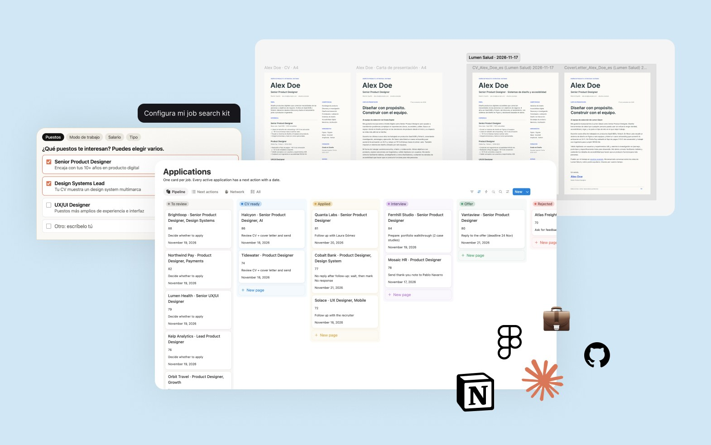
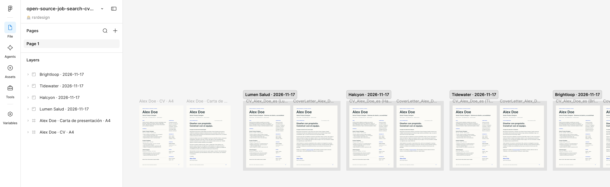
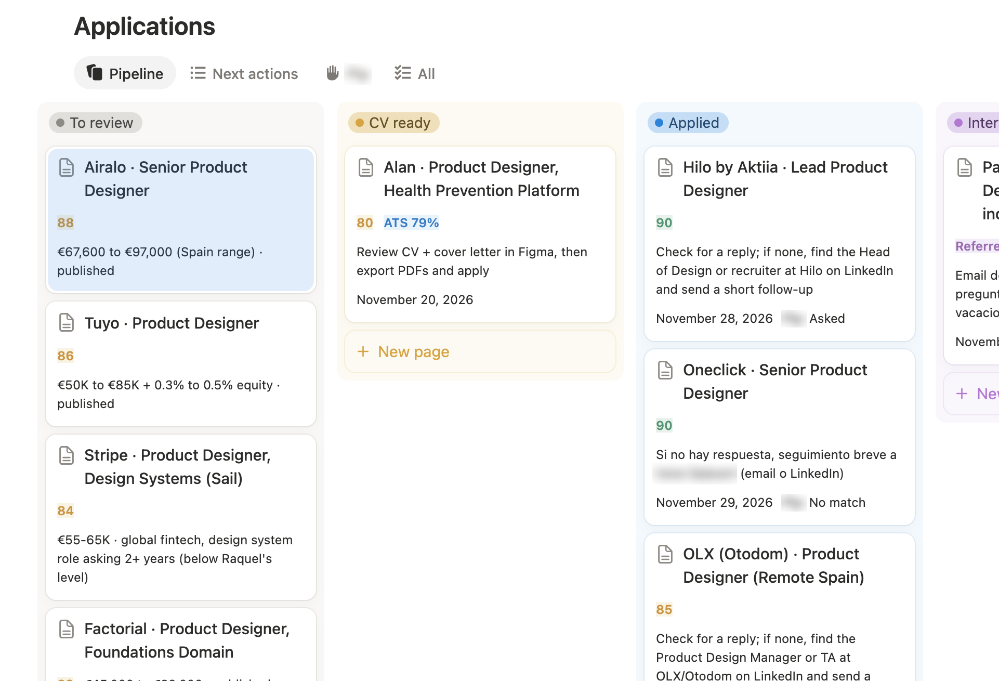
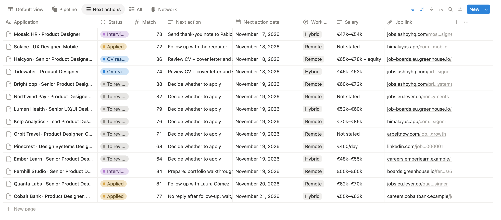

# Job Search Kit

**An AI copilot for your job search**, built by a designer, for designers and anyone with a CV.

You run it with your AI agent (Claude, Codex, Cursor…). It finds roles that fit you, tailors your CV and cover letter for each one, and keeps every application tracked in Notion. **Nothing is sent without you**: you review everything and you hit send.

Built by a product designer for her own job search, then stripped of personal data and shared as a template.



> **You don't need to read the rest of the files.** The folders `.claude/skills/` and `notion/` are instructions for your agent, not for you. You talk to the agent in plain language; it reads them.

## Try it in 2 minutes

No Figma, no Notion, no keys. Download the repo (see step 1 below), open the folder with your agent and say **"Run the demo"**. It searches real job boards for a fictional designer (Alex Doe), scores the roles in the chat and writes a tailored CV and cover letter as text in `_test-applications/`.

## Start in 15 minutes

**You need three things:**

1. **An AI agent that can work with files on your computer**, e.g. the Claude desktop app with a folder connected, Claude Code, Codex or Cursor.
2. **Your current CV**, in any format (PDF, Word, text).
3. **Notion connected to your agent** (free account, see [Notion](#notion)). It's where your applications live.

**Then three steps:**

1. **Get the kit.** Ask your agent:

   ```
   Clone https://github.com/rsrdesign/job-search-kit into a new folder on my computer (for example Documents/job-search-kit) and open it.
   ```

   Or on GitHub click **Use this template** (your own copy) or **Code → Download ZIP**, unzip it and open the folder with your agent.
2. **Add your CV.** Drop it into the kit's `context/` folder. Also add your LinkedIn profile as a PDF if you can (on LinkedIn: your profile → **More → Save to PDF**): it often has roles and projects your CV leaves out.
3. **Say "Set up my job search kit".** It reads your CV first, then asks only what it can't work out, in a short 4-step form (about 5 minutes):

   | Step | Asks |
   |---|---|
   | 1 · About you | Your CV and your portfolio or website |
   | 2 · What you're looking for | Roles, city and work mode, minimum salary, type of contract |
   | 3 · Your files | Where your CV is designed (Figma, Word, Pages, Google Docs or just a PDF), an optional ATS version, the Notion page, the applications folder |
   | 4 · Where to look | Companies you'd love to work for, search days, and whether a mentor will help with intros |

   Every step except the required questions can be skipped. It shows a summary, you confirm, and it builds your Notion board and your settings.

Then say **"Find me new roles"**. When you like one, say **"Prepare my application for #2"**.

## What it does

| | What the kit does | What you do |
|---|---|---|
| **1. Find roles** | Searches company job boards and remote job boards, plus any link you paste (LinkedIn included). Scores each role 0 to 100 against your whole profile and drops the ones that don't fit, like work modes you don't accept. Saves a copy of each posting, in case it's taken down. | Pick the roles you want. |
| **2. Tailor** | Copies your CV and cover letter (Figma, Word, Pages or Google Docs) and rewrites the headline, summary, bullet order, skills and letter for that role. Also makes a **one-column ATS version** for job portals. Never invents experience: it only rewords and reorders what you've done. | Review, tweak and say "export": the PDFs go to the company folder. |
| **3. Track** | One card per role in Notion with status, next action and date. Moves cards when you tell it what happened. | Tell it what you sent and what you heard back. |
| **Optional** | After you apply, suggests who to message at the company and drafts a short note you send yourself. With a mentor who shares their LinkedIn connections, it finds who could introduce you. | Send the note, or ask your mentor. |

**Tailored CV and cover letter in Figma**: your base files stay untouched, and each role gets its own dated section:



**Every application tracked in Notion**, with a status, a match score and one next action with a date:


**Preview of a real board**, from the job search this kit was built for: match score while you review, ATS coverage once the CV is ready, the mentor status only after applying, and a pill for referrals.



<details>
<summary>More screenshots</summary>

Close-up of one Figma section:





</details>

<sub>All names, companies and numbers in these images are fictional, except the real board preview.</sub>

### Ground rules baked into every skill

- **Nothing is sent automatically.** No applications, emails or messages leave without you.
- **No invented experience.** The CV is reworded and reordered, never padded.
- **You own your data.** Your profile, CVs and keys stay on your computer and out of git.

## Two CVs: designed and ATS

Many companies run applications through an **ATS** (applicant tracking system), software that reads your CV as plain text. CVs with columns, often made in Figma or Canva, can come out of a PDF in the wrong order or with broken words. So for each role the kit prepares:

- **The designed CV**, for people: send it when a recruiter or hiring manager asks for it directly.
- **A one-column ATS version**, for job portals and application forms. If you have your own one-column template, the setup asks for it; if not, the kit makes a plain one from the tailored text.

It checks the ATS version the way an ATS would (extracting the text) and sets the PDF's title and author.

## Extras, when you want them

None of these are needed to start. Add them any time by telling your agent.

| Extra | What it's for |
|---|---|
| **Figma** (and its MCP connected) | Tailor a designed CV and cover letter right in your Figma file. Without it, the kit works with Word, Pages, Google Docs or plain text. |
| **Companies you'd love to work for** | The kit checks their job boards directly (Greenhouse, Ashby, Lever). No key needed. |
| **A free search key** ([SerpApi](https://serpapi.com), [Adzuna](https://developer.adzuna.com) or [Jooble](https://jooble.org/api/about)) | Find roles in your city at companies you don't know yet. Copy `.env.example` to `.env` and paste the key there, never in the chat. |
| **A browser tool** (e.g. Claude in Chrome) | Read LinkedIn links, which block most direct reads, and download Figma PDFs if your setup can't reach figma.com. |
| **Access to your Downloads folder** | When PDFs come from Figma through the browser, they land in Downloads first and the agent moves them to each company folder. |
| **Your LinkedIn connections** (or a mentor's, with consent) | After you apply, see who you already know at the company. [How to export them](context/README.md#exporting-linkedin-connections-as-a-csv). |
| **Scheduled searches** | The search runs on its own, e.g. Monday and Wednesday at 8:30 (with the computer on), plus a weekly reminder of what's waiting. |

## Words you'll see

- **Agent**: an AI assistant that can read and write files on your computer and use tools, like the Claude desktop app, Claude Code, Codex or Cursor.
- **MCP**: the way an agent connects to other apps. "Connect the Notion MCP" means letting your agent use your Notion. You do it once, in your agent's settings.
- **ATS**: applicant tracking system, the software many companies use to receive and filter CVs.
- **ATS coverage**: the share of the posting's must-haves your CV names, before and after tailoring.
- **Frame**: a board in Figma. Your CV and cover letter are each one frame.

## Notion

Setup builds a **Jobs tracking** page in the Notion page you choose: a short intro and the **Applications** table, with these tabs:

- **Pipeline**: a board by status (To review → CV ready → Applied → Interview → Offer / Rejected / No response / Discarded), with the match as a coloured pill.
- **Next actions**: active applications sorted by the date of their next step.
- **<Mentor's name>** (only with a mentor): roles where they could make an intro.
- **All**: every application with all its columns.

One manual step: Notion can't reorder tabs from outside, so drag **Pipeline** to the first place once.

**Use a workspace where you're the only member.** On Notion's free plan, a workspace with a single member has unlimited blocks. A workspace with two or more members is capped at 1,000 blocks for its whole life: deleting cards or emptying the Trash doesn't give them back, and each saved job posting uses a few dozen. If you're already capped, create a personal workspace (or remove the other members) and move the Jobs tracking page there, or upgrade to a paid plan.

Saying **"Clean up my board"** keeps the board readable: it saves a one-line summary of each closed role to `context/closed-applications.md` (so future searches still warn you about companies that said no) and moves old Discarded, Rejected and No response cards to Trash, after asking. It doesn't free blocks.

## Works with

The kit is plain Markdown: instructions (`AGENTS.md` / `CLAUDE.md`), skills (`.claude/skills/*/SKILL.md`) and config files. Any agent that can **read and write files, fetch web pages and use MCP** can run it.

| Agent | How it picks up the kit |
|---|---|
| Claude desktop app / Claude Code | Reads `CLAUDE.md` and loads `.claude/skills/` automatically. |
| OpenAI Codex | Reads `AGENTS.md`, which tells it to open the matching `SKILL.md` before each task. |
| Cursor | Reads `AGENTS.md`. Optionally copy `.claude/skills/*` into `.cursor/skills/`. |
| Other agents (Windsurf, Gemini CLI, Copilot agent…) | Point them to `AGENTS.md`, or paste it as the project instructions. |

## Folder structure

```
job-search-kit/
├── README.md
├── AGENTS.md / CLAUDE.md     # instructions for your agent
├── .env.example              # optional search keys (copy to .env)
├── config/                   # *.example.md templates; setup writes your own versions (git-ignored)
├── context/                  # your CV, LinkedIn PDF, portfolio, notes (git-ignored)
├── notion/                   # spec of the Notion board, for the agent
├── .claude/skills/           # the five skills, for the agent
│   ├── job-kit-setup/
│   ├── job-search/
│   ├── tailor-application/
│   ├── application-tracker/
│   └── network-intros/       # optional
└── examples/                 # demo profile ("Run the demo") and a sample network CSV
```

Your applications folder (outside the repo) ends up like:

```
Job search/
├── *Acme/                      # * = active process
│   ├── CV_Alex_Doe_en (Acme) 2026-11-17.pdf
│   ├── CV_Alex_Doe_en ATS (Acme) 2026-11-17.pdf
│   ├── CoverLetter_Alex_Doe_en (Acme) 2026-11-17.pdf
│   └── CoverLetter_Alex_Doe_en (Acme) 2026-11-17.txt   # paste-ready text for forms
└── Globex/                     # closed process
```

## Privacy and fair use

- Your profile, settings, target companies, `.env`, `context/` and any network CSV are git-ignored: they never leave your computer through git.
- A mentor's contacts are their personal data. Only use them with consent and never publish them.
- Respect job boards' terms. For LinkedIn, paste the link or the text; the kit doesn't scrape it.

## Changelog

See [CHANGELOG.md](CHANGELOG.md). Current version: **0.6.1**.

## License

MIT. See [LICENSE](LICENSE).
